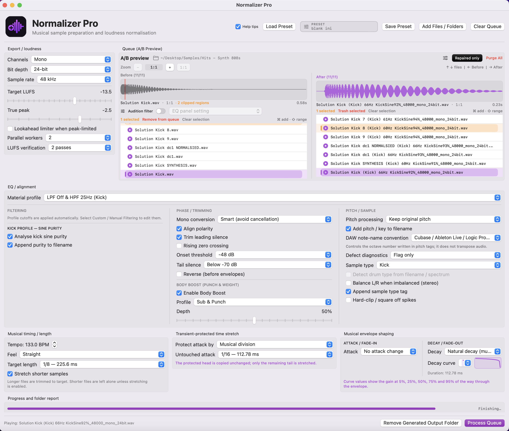
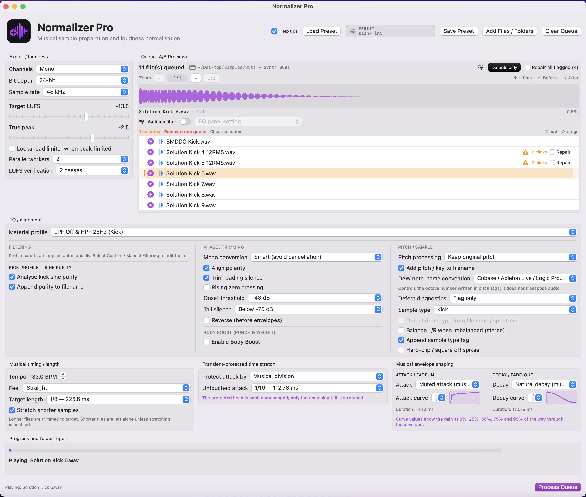

# Normalizer Pro

**Prepare a whole folder of samples in one pass.** Normalizer Pro is a free macOS app from West 9 Studios that cleans up, aligns and loudness-normalises drum and sample libraries, then shows you exactly what it did to every file.

[**Download Normalizer Pro 1.6**](https://github.com/west9studios/Normalizer-Pro-Releases/releases/latest) · macOS 13 or later · 74.6 MB · Free, no account or licence key

## What it does

Drop in files or folders, choose your settings, and process the queue. Your original files are never changed; results go into a separate output folder with a full report.

- **Loudness and true-peak control:** normalise every file to a LUFS target without exceeding a true-peak ceiling, checked after rendering.
- **Cleanup and alignment:** trim leading and trailing silence, align polarity, convert to mono safely, balance stereo and tidy starts and ends.
- **Filtering and tone:** material profiles, high-pass and low-pass filters with selectable slopes, and Body Boost for low-end weight.
- **Pitch and key:** detect the pitch of tonal samples, tune them, and write the note into the filename.
- **Defect scan and repair:** find clicks and clipping on import and repair only the files you choose. Switch it off or set its sensitivity at any time.
- **Musical timing:** set a tempo and grid, trim to length, and stretch short samples while protecting the attack.
- **Attack and decay envelopes:** click-safe, muted or natural fades with a choice of curves, including extreme whipped and ramped shapes.
- **Audition before you commit:** compare Before and After with the arrow keys, and hear a filter on your samples before processing.
- **Reports:** a detailed CSV for every file and a folder length recommendation.
- **Built-in Help Center and one-click updates:** a searchable manual and Learn guides are included, and the app tells you when a new version is available and installs it for you.

## See it in action

<table>
  <tr>
    <td width="50%"></td>
    <td width="50%"></td>
  </tr>
  <tr>
    <td align="center">Defect diagnostics and repair</td>
    <td align="center">Musical envelope shaping</td>
  </tr>
  <tr>
    <td colspan="2"></td>
  </tr>
  <tr>
    <td colspan="2" align="center">Built-in searchable Help Center and report guide</td>
  </tr>
</table>

## What's new

- Software updates: Normalizer Pro now tells you when a newer version is available and installs it for you with one click (Normalizer Pro ▸ Software Update…).
- Defect scan on your terms: switch the scan and repair off completely, or choose how sensitive it is, from the Settings menu or the new slider button above the queue. Your choice is remembered.
- Big folders stay responsive: the scan now works quietly in the background, shows how far it has got, and no longer slows or freezes the window. It also steps aside as soon as you start processing.
- Closing the window now quits the app properly instead of leaving it in the Dock. If a batch is still running you are asked first.
- Five new extreme attack and decay curves for whipped and ramped fades, and every curve now shows its level at 5%, 25%, 50%, 75% and 95%.
- A sharper app icon with the standard Mac shape and spacing.
- Help: the Functions tab now covers every control, menu and shortcut, menu locations have been corrected, and the Learn tab has many new guides.

The full history is in the app under **Help > What's New**.

## Install

1. Download the DMG from the [latest release](https://github.com/west9studios/Normalizer-Pro-Releases/releases/latest).
2. Open it and drag **Normalizer Pro** into **Applications**.
3. Launch the app. If macOS blocks the first launch, open **System Settings > Privacy & Security** and choose **Open Anyway**.

Once installed, Normalizer Pro checks for new versions when it starts. Choose **Update & Relaunch** when the orange notice appears and the app updates itself. Each release also publishes a `.sha256` file if you want to verify your download.

Version 1.6 was released on 14 November 2026. DMG SHA-256: `787abd6e907d6c6742ea3d5a4392a367fe43fceb9595f5862017c1ecfbe2e3af`

## Licence

NORMALIZER PRO — PLAIN-LANGUAGE LICENCE NOTICE

Normalizer Pro is free to use. It remains the property of West 9 Studios.

You may not redistribute, resell, modify, or reverse-engineer Normalizer Pro, or
claim it as your own. No licence key or payment is required to use the app.

Normalizer Pro is provided “as is”, without any warranty, express or implied.
West 9 Studios is not responsible for loss or damage arising from its use.

This is a plain-language notice, not legal advice. It does not replace any
rights or obligations that may apply under the law.
