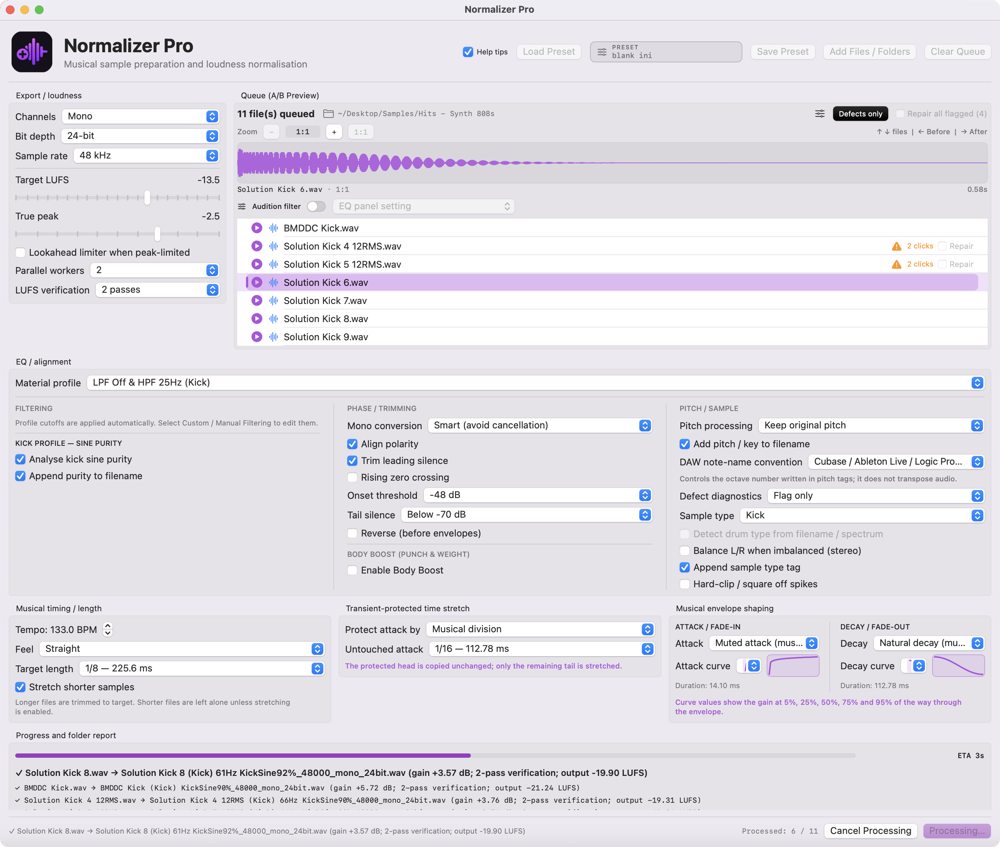

# Normalizer Pro

**Prepare a whole folder of samples in one pass.** Normalizer Pro is a free macOS app from West 9 Studios that cleans up, aligns and loudness-normalises drum and sample libraries, then shows you exactly what it did to every file.

[**Download Normalizer Pro 1.9**](https://github.com/west9studios/Normalizer-Pro-Releases/releases/latest) · macOS 13 or later · 11.7 MB · Free, no account or licence key

## What it does

Drop in files or folders, choose your settings, and process the queue. Your original files are never changed; results go into a separate output folder with a full report.

- **Loudness and true-peak control:** normalise every file to a LUFS target without exceeding a true-peak ceiling, checked after rendering. An optional lookahead limiter lets peaky kicks reach the target cleanly.
- **Fast:** several files are processed at once, so large folders finish quickly. Runs natively on Apple silicon and Intel Macs.
- **Cleanup and alignment:** trim leading and trailing silence, align polarity, convert to mono safely, balance stereo and tidy starts and ends.
- **Filtering and tone:** material profiles, high-pass and low-pass filters with selectable slopes, and Body Boost for low-end weight.
- **Pitch and key:** detect the pitch of tonal samples, tune them, and write the note into the filename. Chord stabs, pads and melodic hits are reported as major or minor with a confidence score (test results in the calibration report).
- **Defect scan and repair:** find clicks and clipping on import and repair only the files you choose. Switch it off or set its sensitivity at any time.
- **Musical timing:** set a tempo and grid, trim to length, and stretch short samples while protecting the attack.
- **Attack and decay envelopes:** click-safe, muted or natural fades with a choice of curves, including extreme whipped and ramped shapes.
- **Audition before you commit:** compare Before and After with the arrow keys, and hear a filter on your samples before processing.
- **Reports:** a clear report page for every output folder (before-and-after loudness, true peak, settings used, defect scan results), a detailed spreadsheet for every file, and a length check that flags any sample stretched by more than 10%.
- **Built-in Help Center and one-click updates:** a searchable manual and Learn guides are included, and the app tells you when a new version is available and installs it for you.

## See it in action

<table>
  <tr>
    <td width="50%"></td>
    <td width="50%"></td>
  </tr>
  <tr>
    <td align="center">Defect diagnostics and repair</td>
    <td align="center">Musical envelope shaping</td>
  </tr>
</table>

## What's new

- Work in progress: this version brings VST3 plugins, hearing plugin changes instantly while a sample plays, and separate processing for the start and the body of each sample. This list will grow as each part is finished.
- Long batches no longer pause when your Mac goes to sleep: it stays awake until the batch is done. The screen can still turn off.
- See how far into a sample you are: the time played and the length show under the waveform while it plays.
- DJ mixer EQ, matched to djay Pro: an Isolator with Low, Mid and High kill buttons, or a Classic club-mixer EQ with three knobs, in the Material profile menu.
- The Material profile menu is tidier: High pass, Low pass and Band pass first, then instrument profiles, custom filters and the DJ mixer, each in its own section.
- Keep an eye on your Mac: the bottom of the window shows how busy it is and how much memory Normalizer Pro is using. Switch it off in the View menu.

The full history is in the app under **Help > What's New**.

## Calibration

Version 1.9 passed 55 of 55 calibration checks on 16 November 2026. [Read the calibration report](CALIBRATION.md). Every release is checked against reference signals before it is published, and you can check your own copy at any time with **Help > Check Calibration…**.

## Install

1. Download the DMG from the [latest release](https://github.com/west9studios/Normalizer-Pro-Releases/releases/latest).
2. Open it and drag **Normalizer Pro** into **Applications**.
3. Launch the app. If macOS blocks the first launch, open **System Settings > Privacy & Security** and choose **Open Anyway**.

Once installed, Normalizer Pro checks for new versions when it starts. Choose **Update & Relaunch** when the orange notice appears and the app updates itself. Each release also publishes a `.sha256` file if you want to verify your download.

Version 1.9 was released on 16 November 2026. DMG SHA-256: `07002faf45bab5cc0656e937ba6e5809059274c8deec4ee75e44233e4052c36b`

## Licence

NORMALIZER PRO — PLAIN-LANGUAGE LICENCE NOTICE

Normalizer Pro is free to use. It remains the property of West 9 Studios.

You may not redistribute, resell, modify, or reverse-engineer Normalizer Pro, or
claim it as your own. No licence key or payment is required to use the app.

Normalizer Pro is provided “as is”, without any warranty, express or implied.
West 9 Studios is not responsible for loss or damage arising from its use.

OPEN-SOURCE COMPONENTS

Normalizer Pro uses FFmpeg (https://ffmpeg.org), included as the separate
programs ffmpeg and ffprobe, licensed under the GNU Lesser General Public
License version 2.1 (LGPLv2.1). West 9 Studios does not own FFmpeg; it belongs
to its authors, the FFmpeg developers (https://ffmpeg.org). The restrictions
above apply to Normalizer Pro's own code only. They do not restrict FFmpeg in
any way: you may study, modify, reverse-engineer, replace and redistribute the
included FFmpeg programs under the terms of their licence. The exact FFmpeg
source code used, and how it was built, are published next to every Normalizer
Pro download, and are described in "Third-Party Notices.txt" (in the disk
image, and in the app under About > Acknowledgements).

PRIVACY

Normalizer Pro does not collect, store or send any personal information, and
your audio files never leave your Mac. The only connection it makes is the
update check: when the app starts, it asks GitHub (github.com) whether a newer
version exists, and it downloads the update from GitHub if you choose to
install it. Like any web request, this lets GitHub see your network address;
GitHub's own privacy policy applies to that. West 9 Studios receives nothing
from these checks. GitHub counts how many times each release is downloaded;
those counts contain no information about who downloaded it.

This is a plain-language notice, not legal advice. It does not replace any
rights or obligations that may apply under the law.
