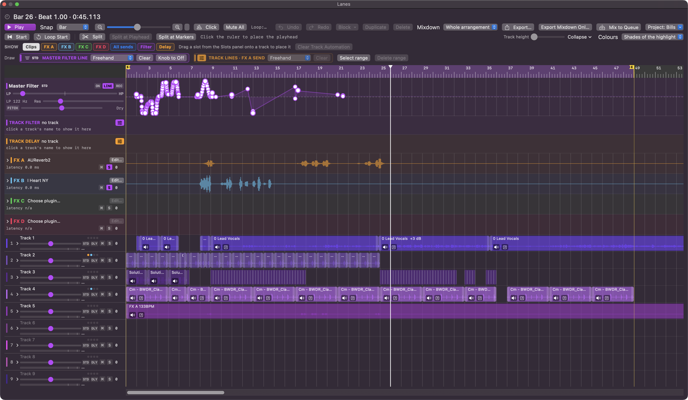
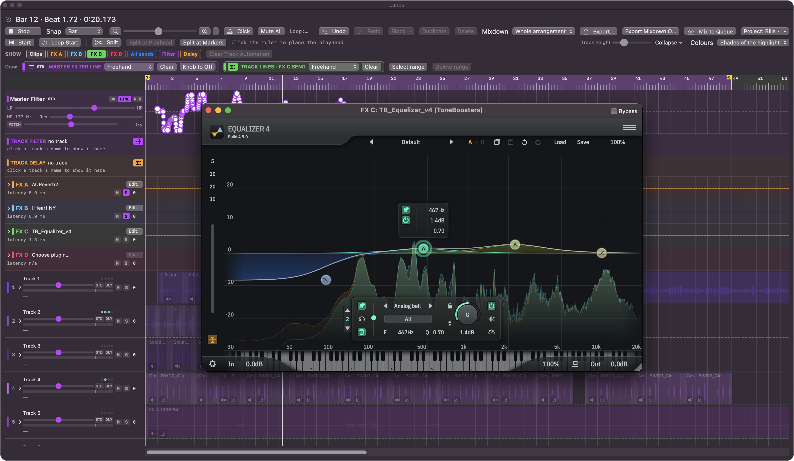
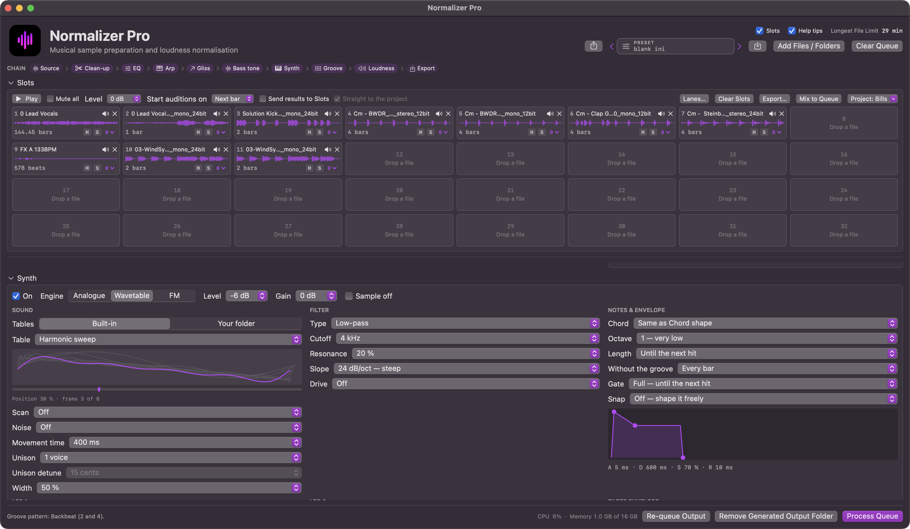
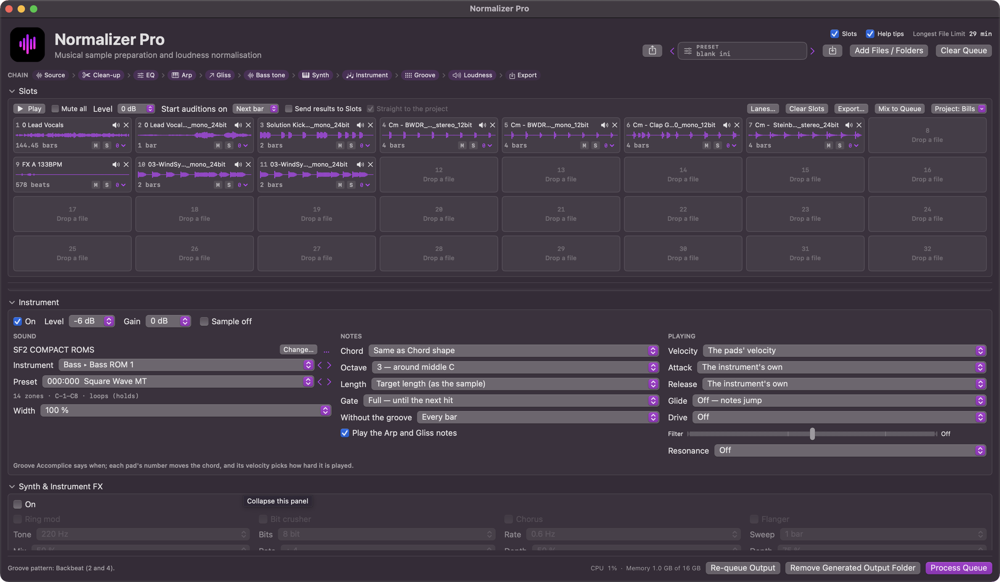
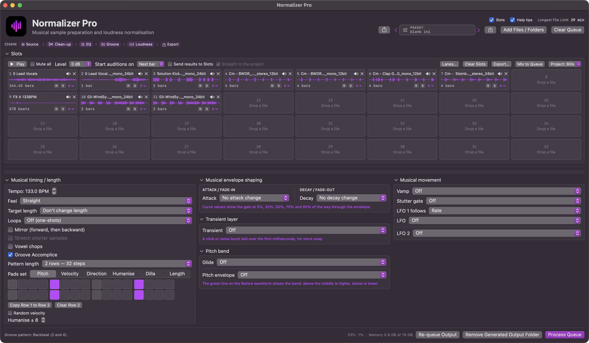
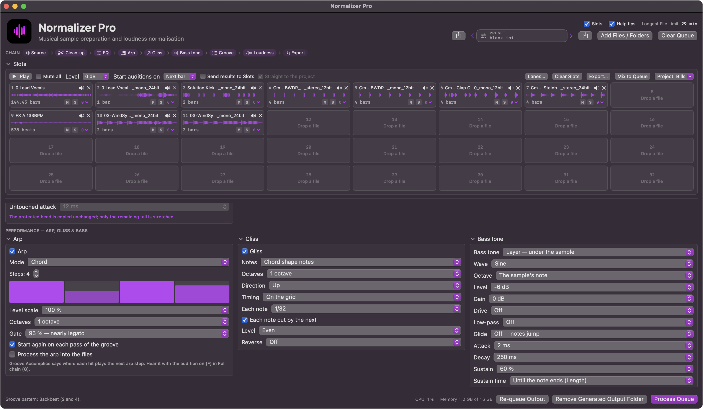

# Normalizer Pro

**Prepare a whole folder of samples in one pass.** Normalizer Pro is a free macOS app from West 9 Studios that cleans up, aligns and loudness-normalises drum and sample libraries, then shows you exactly what it did to every file.

[**Download Normalizer Pro 1.9**](https://github.com/west9studios/Normalizer-Pro-Releases/releases/latest) · macOS 13 or later · 19.5 MB · Free, no account or licence key

## What it does

Drop in files or folders, choose your settings, and process the queue. Your original files are never changed; results go into a separate output folder with a full report.

- **Loudness and true-peak control:** normalise every file to a LUFS target without exceeding a true-peak ceiling, checked after rendering. An optional lookahead limiter lets peaky kicks reach the target cleanly.
- **Fast:** several files are processed at once, so large folders finish quickly. Runs natively on Apple silicon and Intel Macs.
- **Cleanup and alignment:** trim leading and trailing silence, align polarity, convert to mono safely, balance stereo and tidy starts and ends.
- **Filtering and tone:** material profiles, high-pass and low-pass filters with selectable slopes, and Body Boost for low-end weight.
- **Pitch and key:** detect the pitch of tonal samples, tune them, and write the note into the filename. Chord stabs, pads and melodic hits are reported as major or minor with a confidence score (test results in the calibration report).
- **Defect scan and repair:** find clicks and clipping on import and repair only the files you choose. Switch it off or set its sensitivity at any time.
- **Musical timing:** set a tempo and grid, trim to length, and stretch short samples while protecting the attack.
- **Attack and decay envelopes:** click-safe, muted or natural fades with a choice of curves, including extreme whipped and ramped shapes.
- **Audition before you commit:** compare Before and After with the arrow keys, and hear a filter on your samples before processing.
- **Reports:** a clear report page for every output folder (before-and-after loudness, true peak, settings used, defect scan results), a detailed spreadsheet for every file, and a length check that flags any sample stretched by more than 10%.
- **Built-in Help Center and one-click updates:** a searchable manual and Learn guides are included, and the app tells you when a new version is available and installs it for you.

## See it in action

<table>
  <tr>
    <td width="50%"></td>
    <td width="50%"></td>
  </tr>
  <tr>
    <td align="center">Lanes: arrange your samples on a timeline</td>
    <td align="center">Your own Audio Unit and VST3 effects on the FX lanes</td>
  </tr>
  <tr>
    <td width="50%"></td>
    <td width="50%"></td>
  </tr>
  <tr>
    <td align="center">A built-in synth: analogue, wavetable or FM</td>
    <td align="center">Play your own SoundFont and SFZ instruments</td>
  </tr>
  <tr>
    <td width="50%"></td>
    <td width="50%"></td>
  </tr>
  <tr>
    <td align="center">Groove Accomplice, timing and envelope shaping</td>
    <td align="center">Arp, Gliss and Bass tone</td>
  </tr>
</table>

## What's new

- New: DJ mix mastering. Finish a whole DJ mix like a mastered record: choose a preset from DJ mixes (club loud, CD or USB, safe for MP3 / AAC) or switch it on in the Export / loudness panel. The level defaults to −9 LUFS (−8 for club loud) with a −0.3 dBTP ceiling, a gentler limiter made for finished music, and a short fade at each end. Crop the mix with the start and end markers.
- DJ mixes: Match the collection’s level finishes a batch of mixes at one common level, so a set uploaded or burned together plays at a steady volume. The summary tells you the level it chose and how closely the mixes matched.
- DJ mixes: the report now shows the loudest 3-second section and the loudness range of each mix.
- Lanes: Export Mixdown Only has a Looped region only box on its save panel, to write just the looped part whatever Mixdown is set to.
- Add Files / Folders, the MIDI imports and the Mix Check file choosers each remember their own last folder, so choosing a MIDI file no longer moves where Add Files opens.
- Long mix mode (Settings ▸ Problem Files): a whole DJ mix of any length is processed in pieces, so the length limit no longer applies; it needs free disk space for a temporary copy.
- Slots and Lanes: click a speaker again while its clip is playing to stop it.
- Kick Synth: the live preview is now mixed in with the Slots, so a loud kick over a loud mix can no longer clip.
- Kick Synth: Live preview. The kick repeats while you work and every change is heard as you make it — drag a slider, pick a preset or Snap the tune and the sound changes at once. It plays in time with the Slots at your Tempo, so you can tune a kick against your loops; Repeat sets how often it plays.
- Lanes: double-click a point on any line — a send, the master filter or pitch, a track’s filter or delay — to put it back to the middle.
- Lanes: a track’s Filter line is now dry wherever nothing is drawn, with points only where the filter is engaged, as the master filter looks.
- Lanes: tracks can no longer be squashed below the lowest Track height, so they never overlap the track beneath.
- Pitch bend: Restart with each note is always shown now (dimmed until Glide or the pitch envelope is set).
- Lanes: drag a slot onto an event that is already on a track to replace its sound — just that event or every event that plays the same sound.
- Lanes: right-click an event ▸ Hot Swap lists your Slots’ clips so you can audition a replacement in place, then Keep This Sound or Revert.
- Reports: long entries, such as the Notes column, now wrap inside their cell instead of being cut off.
- New: Kick Synth (Slots panel). Make a kick from a falling sine, a sub and a click, tuned to a note, with drive, clip and filters; audition it, put it in a Slot or save it as a WAV.
- New: Project ▸ Open Recent lists the projects you opened or saved lately.
- New: Project ▸ Share / Backup Project saves the project and zips its whole folder to the Desktop, named with the date and time.
- Mix Check: its panel colour can be changed in Settings ▸ Colours, and its tooltips now say that a known good pre-master is a truer reference than a mastered track.
- New: Mix Check in the Lanes. Load a finished track, or a Mix Reference report of a whole library, as the target; Analyse Mix then shows how the mix’s seven frequency bands compare, with a light for each, and marks on the ruler wherever the mix goes over the ceiling or runs louder than the target.
- New: Synth & Instrument FX. Ring mod, bit crusher, chorus, flanger, phaser, delay and reverb for the Synth and the Instrument, with the sample left dry. Echoes and reverb tails loop round cleanly in a groove.
- Groove Accomplice: a pattern library by category — Kicks, Snares, Hats, Fills, Polyrhythms, Hand Percs and more — with ‹ › to step through each one and room for all your MIDI files.
- Groove Accomplice: MIDI drum lanes. Bring in a whole drum part and play it one lane at a time — kick, snare, hats — with ‹ › to cycle through them and the lane's note shown (D1 · Snare).
- Lanes: Master pitch, with its own automation line. Move the pitch of the whole arrangement up or down by up to 24 semitones as it plays, or draw pitch drops and tape-style bends on the master track; the middle leaves it untouched.
- Diatonic chords: the pads' numbers can now move a chord through the key — I, ii, iii, IV, V, vi — instead of moving the same shape up and down.
- Instrument: ‹ › to step through a SoundFont's presets, Glide, Drive, a DJ filter, and it can now play the Arp's and the Gliss's notes.
- Synth: draw the envelope and drag its points, with Snap to note values at your Tempo (or Off to shape it freely). New synths start low and tight: Octave 1, Until the next hit, Attack 5 ms, Release 10 ms.
- Pitch bend's Glide and pitch envelope now bend the Synth and the Instrument too.
- Musical movement: the LFO can restart with each hit, and its filter now comes as Low-pass, High-pass, Band-pass or Notch, with Resonance.
- Fewer pops and clicks: looping in the preview no longer leaves a tiny gap at the loop point, and Synth notes start without a click even with a high Resonance.
- New: the Instrument. Play your own SoundFonts and SFZ instruments with Groove Accomplice — real recorded notes with velocity layers, so pads and chords can be held for a bar or a whole breakdown and still sound like the real thing. Point it at your instrument folder; nothing is copied.
- Cleaner previews: loud stabs and hits no longer click in the Full chain preview, and Synth notes start and end without a click even with the shortest Attack.
- Synth: chords now follow your Target length, as the Bass tone's notes can — set a short Target length for tight stabs, with or without the Bass tone playing. Plus Drive, and Velocity → cutoff so each Groove Accomplice step's velocity opens or closes the filter.
- Lanes: see a track's filter and delay at work. Two new rows under the Master Filter show the highlighted track after its filter, and the echoes its delay adds, drawn just like the FX lanes.
- Groove Accomplice: import MIDI melodies. A single melody, or the top or bottom line of a chord part, comes in with each note's pitch on its pad and its length in Pads set ▸ Length — ready for the Bass tone or the Synth to play.
- Smoother playheads. The playhead now glides across the waveforms and the Lanes on its own, so it no longer stutters while the Synth and Groove Accomplice are busy.
- Groove Accomplice: dotted and triplet note lengths. Beside Pads set ▸ Length, choose Straight, Dotted or Triplet, then drag the pads — a dotted length shows as 3., a triplet as 3T.
- Synth: Length now goes down to 1/32, with triplet and dotted values for every length.
- Synth: two LFOs that move the pitch, the filter, the level, the pan, the wavetable position or the FM brightness, in time with your Tempo — vibrato, wobbles, tremolo and slow sweeps.
- Synth: a filter with a type (Low-pass, High-pass or Band-pass) and an envelope of its own — Amount, Attack, Decay and Sustain — and Osc 1 now has its own tune too.
- Synth: the wavetable picture now follows your pointer at once. Drag across it to move Position, or swipe sideways on a trackpad; the sound changes when you let go.
- Lanes: a track's Filter and Delay each open on their own, and the Draw row's icons now do things — the Master Filter's chooses its style (Standard, Z-Plane, Formant, FM), and the track lines' opens the FX lane's plugin or the highlighted track's filter or delay, which follows whichever track you click.
- Lanes: a wider track column, so more of each name shows; coloured Show buttons and a clearer Play button; an empty FX lane now reads latency n/a.
- Lanes: send a clip back to a Slot raw, or with its track's filter and delay printed in — echoes and all — ready to reverse or process again.
- Click any step in the Chain line to jump to its settings; a folded panel opens on the way.
- Synth: FM. A third engine beside Analogue and Wavetable — one sine bent by another for electric pianos, bells, glassy basses and metallic plucks. Choose the Ratio, the Index (how bright and rough), let the Index fade as each chord rings, and add Feedback for an edgier tone.
- Synth: Sample off. Turn the sample itself off and hear only the synth, the same way the Bass tone's Replace leaves only the bass. The note, length and groove timing still come from the sample. It works on loops too.
- Synth: share presets that use your own wavetables. Tick Include the wavetable in this preset and the table travels with it, so anyone who loads it hears the same sound — even without the file. Your own presets still just point to your folder.
- Synth: if you reorganise your wavetable folder, tables are found again by name. One that has gone missing shows Locate… so you can point to it — still nothing is copied.
- Groove Accomplice: notes of different lengths. Pads set ▸ Length holds each step's note for as many steps as you like, shown as a bar across the pads. The Bass tone and the Synth follow it, so a bass line or chord part can mix long and short notes.
- Synth: use the wavetables you already have. Point it at your wavetable folder and step through the tables with the arrows — nothing is copied, so no wasted disk space. A picture shows the wave's shape and where you are in the table.
- Lanes: clearer drawing tools. The Master Filter line and the track lines each have their own tool box on one Draw row, named and coloured for the line they draw on, and both are always there — so you can shape the filter and the sends side by side without mixing them up.
- The Synth now works on loops too: it plays a chord every beat, bar or few bars in time with the loop, in the loop's own key.
- New: the Synth. A synth of its own that Groove Accomplice plays beside your sample — chords, held notes and pads that never run out. Choose Analogue (two classic oscillators) or Wavetable (shapes that change as the chord rings), add unison for width, shape it with a resonant filter and an envelope, and hold each chord until the next hit or for up to 4 bars. It follows your Chord shape, or plays a chord of its own.
- Lanes: a track's delay Time is now a slider that steps through the note values from 1/16 to a bar, instead of a menu.
- Normalizer Pro now starts in Dark mode, whatever your Mac is set to. Settings ▸ Colours… ▸ Appearance switches to Light or Match the Mac.
- Lanes: the playhead now glides smoothly across big projects instead of stepping, the , (comma) key always reaches the Lanes when their window is in front, and a node you drag no longer goes missing — dropped on another node’s beat, it takes that node’s place.
- Lanes: every track now has its own DJ filter under its name, with four characters — Standard, Z-Plane, Formant (a talking filter) and FM — and its own echo: Stereo, Ping-pong or Tape, in time with your Tempo. Draw automation for both on the track (Show ▸ Filter or Delay), or record it by moving the knobs while it plays. Export includes them.
- Lanes: zoom out far enough to see any arrangement, and in much deeper. A Fit button zooms the whole arrangement across the window, the zoom slider is gentler and steps are smaller, and the zoom stays on the playhead. A scroll bar now runs across the bottom of the window.
- Lanes: drag the small arrow on an event onto a Slot (or right-click ▸ Send to a Slot) to take it back, as it sounds, and process it again.
- Lanes: the two playhead keys were the wrong way round. ` (backtick) now goes back to the start of the track and , (comma) to the start of the loop. The playhead moves more smoothly on big projects, and node handles no longer get cut off at the edge of a lane.
- Lanes: 64 tracks (the Slots stay at 32). Collapse a track to one thin row, collapse all the empty ones, or show them all again. ⌘-click a send or filter line to add a node, drag a node to move it, ⌘-click a node to remove it. ⌘-drag the end of a clip to stretch the sound to fit. Drag a selection box to the edge of the window and the lanes scroll with it. A track's FX dots now stay at the right of its name.
- Slots: a Clear Slots button empties every slot and leaves the clips in the Lanes where they are.
- Export Mixdown Only now waits for stretched or pitched clips to be ready, so the mix stays in time.
- Slots and Lanes are now independent: empty a slot, or clear all the Slots, and the clips you laid out in the Lanes keep playing their sounds. Build a kit or a song starter 32 sounds at a time, then reuse the Slots for the next batch.
- Bass tone: Attack, Decay and Release can be set as note values at your Tempo as well as milliseconds, and a new Sustain time holds each note for a note value.
- Lanes: the ruler now stays at the top of the window as you scroll down through the tracks.
- Lanes: renaming a track puts the cursor straight into the name, so you can type at once.
- Lanes: Export Mixdown Only asks for a name, starting with the project name and the date and time.
- Lanes: the ruler now stays in view at the top while you scroll down through the tracks.
- Lanes: an effect plugin's window now shows its live meters and displays while the arrangement plays, fed with the sound that lane is sending to it.
- Lanes: an FX lane now starts and stops exactly where the send line you drew does. Before, a line that ended above zero kept feeding the effect after its last point, and the wet waveform was drawn a little early.
- Lanes: deleting a stretch of a send line no longer leaves spikes behind, and deleting a spike no longer just moves it along.
- Lanes: every peak of a send line or the filter line has its own handle. Drag one up or down to make just that peak larger or smaller.
- Lanes: Clear this line now clears only the highlighted tracks (click a track's name; ⌘-click adds more).
- Lanes: you can name each track (double-click its name), move tracks by dragging them or with Move Up / Move Down, and expand any track or FX lane to see its waveform larger.
- Lanes: FX A to D can be highlighted by clicking them, and soloing an FX lane now plays only its effect signal.
- Lanes: the level reading under each track's meter is larger, the position display follows the playhead when you move it, and clicking Normalizer Pro's main window brings it in front of the Lanes window.
- Lanes: Export Mixdown Only writes just the mix as one file, with no stems.
- Bass tone: Glide can be a musical division as well as milliseconds. Gliss: Each note now offers 1/8.
- Lanes: every track has a level meter with a reading. The bar moves with the track as it plays, a thin marker holds the highest recent peak, and the number beside it gives that peak in dB (red above 0 dB).
- Before / After: ← and → now start from your start marker (where you clicked the waveform, moved with , and . or paused) instead of always going back to the very start of the file. Esc still takes you back to the start.
- Lanes: the playhead now lands on the Snap when you click the ruler or drag its arrow, so it sits exactly on a bar, beat or note value. A new Snap choice, Off, lets the playhead, the blocks and the loop range move freely.
- Chord shapes: a new Lock to target length cuts the whole chord, the lowest note too, exactly where the sample ends (Target length, or the sample’s own length when none is set), so the low note no longer rings on and smears into a separate bass line. It holds for strums, the Arp, Gliss and Groove Accomplice’s pads. Off, the chord behaves as before.
- Audition: the Lanes’ FX A to D no longer play on every Before sample. Track FX buttons under the audition controls (none by default) let you add any of them to the audition when you want to hear it.
- Chord shapes: a new Chord octave moves the whole chord up or down by up to three octaves, shape kept, so you can step through the octaves to find the one that suits the sample. Before, a chord could only sit on or above the sample's own note.
- Lanes: the playhead's bar, beat and time are shown above the lanes, and move as the arrangement plays. Stopped, they show where Play will start.
- Lanes: the cursor becomes a pencil over a line you can draw on (the FX send lines and the Master Filter line), and a crosshair while Select range is on.
- Plugin windows: Edit… on a plugin slot or an FX lane now brings the plugin's window to the front, above the Lanes window.
- The Lanes window and plugin windows stay in front of Normalizer Pro's own windows only while Normalizer Pro is the app you are using, so Finder and other apps' windows can come to the front again.
- When processing finishes, the preview now stays on and uses the Full chain, so Before keeps showing your current settings (Mono or Stereo, length, plugins) as you change them, while After plays the files already made. Press F to hear the original.
- Tools: a new panel with a Ducker — the pumping of a side-chain compressor, in time with your Tempo, with no kick needed — and a Tremolo whose rate is a musical division (or free, in Hertz) and can be moved by its own LFO.
- Lanes: Start (key ` backtick) and Loop Start (key , comma) take the playhead back to the start of the track or of the loop — playback carries on if it is playing.
- Lanes: click the bar ruler to play from that point.
- Lanes: Split cuts blocks at a playhead you place freely while playback is stopped (key X); the two halves play as one.
- Lanes: fades have a Whole sample choice, running across the whole block.
- Lanes: Snap now has a half and a dotted and a triplet choice for every note value.
- Slots and Lanes: there are now 32 slots (and 32 lanes), up from 16.
- Lanes: each lane has its own colour (shades of your highlight colour, different colours, or one colour — your choice above the lanes).
- Lanes: while stopped, clicking a block moves the playhead to that spot, ready to split or edit there.
- Groove Accomplice: Random velocity (between a Min and a Max), a Humanise choice for the pads you mark (so ghost hits breathe while the backbeat stays put), a frame that follows the step being played, and Step lengths of a bar, a half and a quarter — each straight, triplet or dotted.
- Lanes: Undo and Redo; Gain in a clip’s right-click menu; Clear Track Automation; select a stretch of an automation line and delete it; a freehand line’s start and end land on the Snap.
- Slots: a speaker on each slot plays it, to flick through before dragging to a track.
- Lanes: a Master Filter track at the top — a DJ-style low-pass / high-pass on the whole arrangement, one knob with the middle off, a Resonance control and an automation line you can draw, or record by moving the knob while it plays. It moves with no delay, and Export includes it.
- Lanes: four FX lanes at the top, each with one plugin, a latency read-out, Mute and Solo. Every track sends a copy of its sound to them along lines you draw, with a line tool that has Freehand, Line, Sine, Square, Triangle, Saw and several modulation shapes. View one line on its own (FX A–D) to draw it easily.
- Lanes are now separate from the Slots: drag a slot from the Slots panel onto a track to place it, and move clips freely between tracks (up and down as well as along). 32 tracks.
- Lanes: a speaker on each clip plays it on its own, and Reverse is in the clip’s right-click menu.
- LFO 1’s filter can follow Groove Accomplice’s velocity instead of a rate (LFO 1 follows ▸ Groove velocity): each hit opens the filter by its own velocity, with an Invert the envelope option so it starts open and snaps back closed.
- Vowel chops: a Sensitivity control sets how readily vowels are found.
- Lanes keys: Space plays and stops the arrangement, + and − zoom, E exports.
- Bit depth: 12-bit (Akai S900 / S950, MPC60), saved in a 16-bit WAV with the sound brought down to 12 bits, and a 40 kHz sample rate for the S900 and MPC60.
- Groove Accomplice: Patterns ▸ Import MIDI File turns the notes of a one-lane MIDI file into a pattern — each note goes to the nearest step and its velocity becomes the step’s velocity — and a second choice keeps how far each note sat from its step as Dilla timing.
- Chord shapes: Reverse every other voice plays the second, fourth, sixth… voice of the chord backwards, after any cut to the target length.
- Bass tone: its own Gain, and Release times of 0 to 5 ms. Feel offset: 1/8 notes (straight, triplet, dotted) added.
- Groove Accomplice: a Dilla tab in Pads set. Drag a pad up to play that step later, down for earlier, to get a laid-back feel from steps moving against each other. (Feel offset moves every hit together, so with the groove on it only slides the whole pattern.)
- Vamp: a Standard / Advanced choice. Standard gives the vamp a level slider right under the Vamp setting; Advanced dims it and uses the Vamp section below Head & Body (level, filters and plugins) instead.
- Keys swapped: Space now plays and stops the Slots and Lanes, and B plays and pauses the audition.
- Lanes: clicking the ruler, or dragging the playhead arrow along it, only moves the playhead — nothing plays until you press Space.
- Lanes: widening the window no longer leaves a gap between the track list and the arrangement.
- Work in progress: this version brings VST3 plugins, hearing plugin changes instantly while a sample plays, and separate processing for the start and the body of each sample. This list will grow as each part is finished.
- Processed files now have a home of their own: Documents ▸ Normalizer Pro Batch Processing, a folder for each source folder named after it with the date and time (for example “Kicks Processed 2026-11-19 01.05”). Your sample folders stay untouched. Settings ▸ Batch Output switches back to saving beside the sources.
- Making sounds only for the Slots? Tick Straight to the project and the results go straight into the Slots project, with no batch folder.
- Slots projects save themselves every 3 minutes when they have changes (Settings ▸ Sequencer, on to start with).
- Lanes: trim a block from its start as well as its end — the other end stays put, so a two-bar loop can start on its second bar.
- Lanes: select several blocks at once — ⌘-click, ⇧-click, drag a box across the lanes, or ⌘A — then move, duplicate, delete or change them together. Copy, cut and paste blocks with ⌘C, ⌘X and ⌘V.
- Lanes: the loop range has yellow S and E flags, as a sample's start and end markers do; drag one to move that end.
- Lanes: Export and Mix to Queue can cover the loop range, the whole arrangement or just the selected blocks (Mixdown).
- Lanes: the track list is narrower, ending right after each lane's level, so more of the arrangement is in view.
- Lanes: stretching a block no longer stalls the app; a stretch is prepared once, in the background.
- Lanes: the window no longer stops responding while you arrange, even with lots of blocks, and zoomed out the timeline fills the window instead of starting part-way across it.
- Groove Accomplice: switching it on also ticks Process the groove into the files.
- Groove Accomplice: right-click a pad to type its value — a velocity such as 113, or a pitch such as 7 or −5. A single click only switches the pad on or off.
- Groove Accomplice: a third pad tab, Direction, plays any step backwards — a reverse snare or hat swelling into the next hit.
- Groove Accomplice: Clear Intervals shows on the Pitch tab and Clear Velocities on the Velocity tab, each only where it applies.
- Chord shapes: Major, Minor and Dominant 13ths, a wide 7/9 Open Hand voicing, and inversions (1st, 2nd and 3rd).
- Bass tone: Length can follow Target length, so each note is as long as the sample; Nudge ‹ › moves the bass line a step earlier or later — onto the off-beat, or a beat behind.
- Glide time and Strum time can be note values at your Tempo, up to a whole bar.
- Strum curve shapes how the strummed notes are spaced, with the same curves as the fades.
- Arp Gate now runs from 50 % to 95 %.
- Pitch changes always work as a sampler does (higher is shorter): Keep length is gone, as it didn't sound good enough.
- Contributor presets: a third bank in the preset menu, after your own, with presets shared with each release.
- Vowel chops: give it an acapella and it keeps only the vowels — A, E, I, O, U — in one file; with Groove Accomplice, each pad chooses a vowel (0 A to 4 U) to play.
- Arp: a new Grains mode fires the chord's notes as a cloud of grains — Spread, Density and Randomness.
- Strum: Call & response adds the notes the chord leaves out, after the chord or alongside it, from the relative key or the fifth.
- Strum hold: strummed notes start short and grow longer.
- LFO: Rate steps — a different LFO speed on each of 16 steps, for wobbles in time.
- Groove Accomplice: every pad has its own velocity (1–127). Choose Velocity above the pads and drag a pad down to play it softer. The pad numbers are a little smaller.
- Changing the bit depth, dither or sample rate is now heard straight away in the Full chain audition (before, it only came through after switching between Mono and Stereo).
- The Load Preset icon now matches the Save Preset icon's height.
- Bass tone: a clean, low tone that plays with Groove Accomplice. Layer puts it under every hit, following the sample's note and each pad's number, so it never clashes with a chord. Replace plays only the tone, as a bass line drawn on the pads. Pick a pure sub, sine, triangle, soft square or saw, an octave, drive, a low-pass, the note's shape and a glide; with Head & Body on, put it under the whole sample, the head or the body.
- Groove Accomplice patterns can be up to 128 steps: choose 1 to 8 rows of 16 with Pattern length.
- Groove Accomplice pads are tidier: all the same size, evenly spaced, with a larger number showing each pad's pitch — white for up, black for down. Click a pad to switch it on or off, right-click to type its value, drag up or down to change it.
- Arp and Gliss panels say so plainly, and grey out, while the Bass tone replaces the sample (Chord shape and Strum too).
- Lanes: every block is an event of its own — change its pitch in semitones (it stays in time), stretch it to twice as long at half the speed, trim it, fade it in and out, mute or solo it, duplicate or delete it. Snap goes down to 1/128 triplet, and Mute All / Unmute All puts every lane back in one click.
- Groove Accomplice has its own patterns: save a rhythm and load it under any sound, or start from a built-in one (four on the floor, boom bap, clave, two bass lines and more).
- Arp and Gliss have their own Performance row, side by side under the main panels (the Bass tone joins them); their tick boxes switch them on and off without hiding the settings.
- Load and Save Preset icons are now the same height as the buttons beside them.
- Snap notes to the key, for the chord, Arp, Gliss and groove intervals.
- Groove, Arp, Gliss and LFO 2 changes are heard almost at once while the Full chain audition plays.
- Slots projects: everything the Slots use lives in one project folder (Documents ▸ Normalizer Pro Projects, or your own). Save Project and Open Project keep the slots, levels, the Lanes arrangement and the Tempo.
- Playheads on every slot and in the Lanes window.
- Arp: fire your chord shape step by step — the whole chord through the octaves (Chord mode), or note by note — with a level per step and a gate for tight staccato. Groove Accomplice decides when each step fires.
- Gliss: turn each note into a run up or down the chord or a scale, on the grid or over a set time.
- Strum: the chord's notes start one after another, down, up or alternating.
- Groove Accomplice pads can each play at their own pitch: drag up or down on a pad.
- Lanes: arrange the Slots on a timeline in their own window, as an alternative to looping clips (Settings ▸ Sequencer).
- Vamp goes down to 1/128, and Vamp curve shapes how the lead-in swells up to the hit.
- Head & Body and Vamp: the plugin menus line up with the Plugin chain panel's.
- Slots: send a slot back to the queue (right-click, or drag it out), and drop a folder on the Slots to reload it.
- Loop with the Slots playing repeats a groove on its own length — no more silent extra bar after it.
- Groove Accomplice File length goes up to 64 bars; Glide and the pitch envelope name each interval with its direction.
- Slots: up to 32 slots that loop your processed grooves in time while you find the next sound — send results to them, audition in context, then export stems and a mix as a song starter.
- Init at the top of the preset list: a clean start with default settings.
- Glide: bend the pitch into each hit. Pitch envelope: a longer bend at the start or the end, with the fade curves, drawn as a green line on the waveform.
- Vamp with Groove Accomplice: every beat lands on the grid with its vamp in front.
- Files written with the groove have the tempo in their name.
- Groove pads are square.
- Process Selected: process just the files you've selected in the queue.
- Drag a sample out of the Before list for a copy of the original, or out of After for the processed file.
- LFO 2 moves each Groove Accomplice hit's start or end point, so how much of the sample plays changes hit by hit.
- Groove Accomplice has two rows of 16 steps, for call and response.
- Loop slices: Pattern plays over — run My pattern across 1, 2, 4 or 8 bars.
- Loops: Target length goes up to 4 and 8 bars, and Found tempo can double a loop heard at half speed (drum & bass at 170 found as 85).
- When a batch finishes and nothing is playing, the After list takes over, so the next play is the processed sound.
- Loop no longer makes an open menu flicker each time the sample starts again.
- With one of your own presets loaded, ‹ › step through your presets only.
- Load and Save Preset are icons; Help tips sits beside Longest File Limit; the musical panels keep their own heights, and Transient layer sits under the envelope panel.
- Groove Accomplice: choose how long each processed file plays the pattern for — once, or 1 to 64 bars — and pick any swing from 51 to 75 %.
- Add Files / Folders opens reliably again.
- Transient layer has its own small panel, under Musical envelope shaping.
- The Mono to wide stereo preset now shows its 12 ms Pseudo-stereo setting, and 8 ms and 12 ms are in the menu.
- Longest File Limit sits above the buttons at the top right; loop slice squares have more room, and Reset Slices puts them back in order.
- Groove Accomplice has swing, from straight to a hard shuffle.
- Head & Body has its own panel, before the plugin chain — which works on the whole sample, after Head & Body.
- Example presets for one-shots, loops, mono and stereo, each with a description: click the preset name for the menu, or ‹ › to step through them. Reset to Defaults starts over (with a warning).
- Start / end markers: trim a sample by hand with two yellow markers on the waveform.
- Head & Body: Manual is now the default — drag the line, with a warning when different sounds are queued — and you can keep just the head or just the body.
- Attack and decay fades are drawn across the waveform.
- The timing, envelope and movement panels share the space evenly, with nothing spilling over.
- Mix Reference moved to the app menu: Other Products from West 9 Studios.
- The Open Report button goes away when the output it described is removed or re-queued.
- Groove Accomplice: hear each one-shot in your own rhythm, from squares you switch on and off.
- Unison for one-shots: double a sample an octave, a fifth or a fourth up or down.
- Head & Body: a Manual split — drag the line on the waveform, with a left-right cursor to show when you can.
- Loop slices: pick each step's slice with squares instead of typing.
- The Chain line wraps onto a second row instead of running off the edge.
- Keyboard shortcuts and selecting rows are quick again.
- Head & Body: listen to the head or the body on its own while you set them up.
- Before and After waveforms in different colours (and your own choice in Settings ▸ Colours…), plus colours for the panels and the text.
- A Chain line at the top of the window shows every step that's switched on, in the order it happens.
- Lookahead compressor: evens out each finished sample before loudness, catching every peak cleanly.
- The arrow keys no longer switch the audition on and off — only F does.
- Whole-sample fades, the gate and the LFO no longer restart where you click on a long file: they follow the whole sample.
- The LFO filter now sweeps inside your material profile's low-pass, so you can hear it on top of the profile.
- Self-test: every musical feature is checked on its own and chained together.
- Chord shapes: turn one sample into a chord — triads, 7ths, 9ths, 6/9 and 7/9, major, minor or dominant, in a closed or open hand — with each voice's steps shown in semitones.
- Drag the Head & Body line on the waveform to move one file's split by hand.
- LFO: pan (with depth as the width), a filter range and slope (6, 12 or 24 dB/oct), and an L/R offset that sends the movement across the stereo field.
- Loops: play the slices in another order — reversed, shuffled or your own pattern.
- Every processed file names Normalizer Pro and its download page in its details.
- About and the Help menu link to Mix Reference, our other app.
- The Dilla Feel guide is now a proper tribute to J Dilla.
- Self-test results are shown in full; nothing is cut off.
- New keys: P processes the queue, Q re-queues the output, and / (the ? key) now switches Auto-play on and off.
- Help is easier to read: long explanations are broken into short paragraphs, and there is a Keyboard Shortcuts page (Help menu) with every key in one table.
- New Learn guides: getting loud with the limiter, the Dilla feel, Vamp, the stutter gate, the LFO, polyrhythms, Head & Body (with kick and snare examples), mirroring and reverse foldback, and delay-style effects made from the musical tools.
- Stutter gate: sharp, scratch-style cuts by default, a choice of edges (Sharp, Tight, Smooth), and clearer wording — Sound per step shows how much of each step you hear, with the timing in milliseconds.
- After re-queuing, you can clear the earlier output folders in one go and keep only the newest pass.
- After removing the output, the audition comes back on if you were using it.
- When a batch finishes, the window returns to the waveforms at the top and stays there.
- Re-queue Output: send your processed files straight back into the queue for another pass — a second plugin, a different loudness, a new length — without hunting for them in Finder. Your first results are kept.
- Live plugins: in Filters & plugins mode your plugins now play live as you audition. Turn a knob and you hear it instantly, the plugin’s meters and displays move with the sound, and reverb and delay tails ring out naturally.
- Full chain plays your plugins live too, so you can dial a plugin in while hearing the finished sound — fades, loudness and all — with no waiting for it to be prepared.
- Head & Body split: give the hit and the ring of each sample their own level, filters and plugins — a transient shaper on the head and a reverb on the body, say — and hear it live as you set it up.
- Loops: step through a loop one Target length at a time with Start (sample the kick, then the next sixteenth, and so on). And Mirror, for any sample: forward then backward, for swells.
- Fades that last the whole sample: choose Whole sample for the attack or the decay and the fade runs from one end of the sample to the other, whatever its length.
- Transient layer: add a click or a burst of noise to the start of each sample for extra snap.
- Reverse out of the tail: a sample shorter than the set length can finish by playing back out of its own tail instead of stopping early.
- Lo-fi exports: 8-bit, and 8 kHz or 11.025 kHz sample rates, for that old-sampler crunch.
- Pseudo-stereo: spread mono samples across the stereo field by delaying one side a few milliseconds.
- Movement: a stutter gate and an LFO (volume or filter) in time with your Tempo, and Vamp — a reversed lead-in that sucks into the hit, with its own level, filters and plugins.
- Feel offset for one-shots: drag a sample behind the beat (or push it ahead) by ticks, milliseconds or a note value — the J Dilla feel.
- Triplets and dotted notes for every musical setting: gate, LFO, vamp, feel offset and the Head & Body split.
- Polyrhythm for loops: fire one slice of a loop at its own note value across the bar, for rhythms that cut against the beat.
- Head & Body: a clean split option keeps each side's effects to its own part, and the split point shows on the waveform.
- Tempo-synced plugins now follow your Tempo setting (or a loop’s own tempo when Loops is set to Keep own tempo), so a delay set to 1/8 lands on the 1/8 at your tempo instead of at 120 BPM.
- Previews are much quicker and far lighter on the processor — in both Filters & plugins and Full chain, with or without plugins — and waveforms of long files appear sooner. The fans should no longer spin up while you audition.
- New keys: , (comma) and . (full stop) move the playhead back and forward along the waveform — finer steps when zoomed in — and G switches the audition between Filters & plugins and Full chain without stopping.
- More loudness room: Target LUFS now goes from −24 up to −5 LUFS and the true-peak ceiling up to 0 dBTP, in finer steps. The lookahead limiter has a Limiter depth setting (6 to 24 dB), and when files end up quieter than your target the batch summary says how many and what to change.
- The Latest button in the progress log is now solid, so it no longer blends into the text behind it.
- If a waveform ever goes missing, clicking it or playing the sample brings it back, and clicking still plays from that point meanwhile.
- Older Intel-only VST3 plugins work on Apple silicon Macs too: they run through Rosetta in a small companion program, and their window opens beside Normalizer Pro. If one crashes, Normalizer Pro carries on.
- VST3 plugins: the Plugin chain now runs VST3 effects as well as Audio Units, in any mix. Each plugin opens in its own window as usual, its settings are saved in your presets, and its delay and tail are handled exactly like an Audio Unit’s. A plugin you have in both formats is listed once, as VST3, and the menu shows each plugin’s format. Choose Look for New Plugins in the plugin menu after installing new ones.
- Long batches no longer pause when your Mac goes to sleep: it stays awake until the batch is done. The screen can still turn off.
- See how far into a sample you are: the time played and the length show under the waveform while it plays.
- DJ mixer EQ, matched to djay Pro: an Isolator with Low, Mid and High kill buttons, or a Classic club-mixer EQ with three knobs, in the Material profile menu.
- The Material profile menu is tidier: High pass, Low pass and Band pass first, then instrument profiles, custom filters and the DJ mixer, each in its own section.
- Keep an eye on your Mac: the bottom of the window shows how busy it is and how much memory Normalizer Pro is using. Switch it off in the View menu.

The full history is in the app under **Help > What's New**.

## Calibration

Version 1.9 passed 55 of 55 calibration checks on 27 November 2026. [Read the calibration report](CALIBRATION.md). Every release is checked against reference signals before it is published, and you can check your own copy at any time with **Help > Check Calibration…**.

## Install

1. Download the DMG from the [latest release](https://github.com/west9studios/Normalizer-Pro-Releases/releases/latest).
2. Open it and drag **Normalizer Pro** into **Applications**.
3. Launch the app. If macOS blocks the first launch, open **System Settings > Privacy & Security** and choose **Open Anyway**.

Once installed, Normalizer Pro checks for new versions when it starts. Choose **Update & Relaunch** when the orange notice appears and the app updates itself. Each release also publishes a `.sha256` file if you want to verify your download.

Version 1.9 was released on 27 November 2026. DMG SHA-256: `8dfa79034f239e3284d132015cc1593c7cab4e34d1815c42ba1430ea53e0b43d`

## More from West 9 Studios

- [Normalizer Pro](https://github.com/west9studios/Normalizer-Pro-Releases): prepare a whole folder of samples in one pass.
- [Mix Reference](https://github.com/west9studios/Mix-Reference-Releases): compare your mix with reference tracks, band by band.
- [Mac Utility](https://github.com/west9studios/Mac-Utility-Releases): audio workstation maintenance: disk space, plugins, startup items and sample-library tidying.
- [Sample Analyzer](https://github.com/west9studios/Sample-Analyzer-Releases): analyse entire folders of samples for loudness, true peak, instrument detection and mix balance.

## Licence

NORMALIZER PRO — PLAIN-LANGUAGE LICENCE NOTICE

Normalizer Pro is free to use. It remains the property of West 9 Studios.

You may not redistribute, resell, modify, or reverse-engineer Normalizer Pro, or
claim it as your own. No licence key or payment is required to use the app.

Normalizer Pro is provided “as is”, without any warranty, express or implied.
West 9 Studios is not responsible for loss or damage arising from its use.

OPEN-SOURCE COMPONENTS

Normalizer Pro uses FFmpeg (https://ffmpeg.org), included as the separate
programs ffmpeg and ffprobe, licensed under the GNU Lesser General Public
License version 2.1 (LGPLv2.1). West 9 Studios does not own FFmpeg; it belongs
to its authors, the FFmpeg developers (https://ffmpeg.org). The restrictions
above apply to Normalizer Pro's own code only. They do not restrict FFmpeg in
any way: you may study, modify, reverse-engineer, replace and redistribute the
included FFmpeg programs under the terms of their licence. The exact FFmpeg
source code used, and how it was built, are published next to every Normalizer
Pro download, and are described in "Third-Party Notices.txt" (in the disk
image, and in the app under About > Acknowledgements).

PRIVACY

Normalizer Pro does not collect, store or send any personal information, and
your audio files never leave your Mac. The only connection it makes is the
update check: when the app starts, it asks GitHub (github.com) whether a newer
version exists, and it downloads the update from GitHub if you choose to
install it. Like any web request, this lets GitHub see your network address;
GitHub's own privacy policy applies to that. West 9 Studios receives nothing
from these checks. GitHub counts how many times each release is downloaded;
those counts contain no information about who downloaded it.

This is a plain-language notice, not legal advice. It does not replace any
rights or obligations that may apply under the law.
